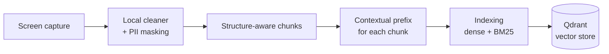
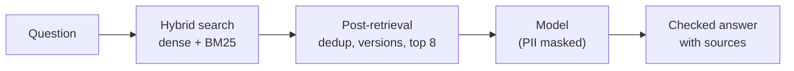
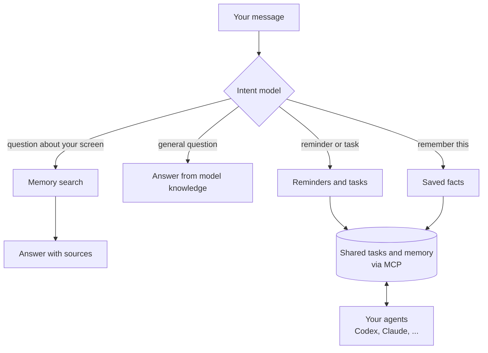

# Cortex

Cortex is a local-first brain for you and your agents. It remembers everything that happens on your screen and lets you ask about it later. It spots reminders and tasks in your conversations and suggests them.

It is also a shared task and memory space for your agents. Start a task in Codex, hand it to Claude, and the context goes with it, with no copying and pasting. Memory tools like mem0 store facts, but they don't help agents split up and pass work between each other. Cortex does.

<p align="center"></p>


## How it works

Cortex reads what is on your screen and keeps it in a local RAG on your Mac. Then you can:

* **Ask** questions about anything you saw, read or wrote.
* **Remember** things like emails and phone numbers.
* **Create reminders and tasks** from your conversations, and share them with your agents.
* **Get nudged** about things you might have missed, like a meeting or a task someone asked you about. This is planned and not active in this build.



* **Screen capture:** reads the text of the window you are in, only after you opt in. Terminals, password managers and private windows are skipped.
* **Local cleaner:** strips menus, buttons and sidebars, and keeps who said what and when.
* **PII masking:** card numbers, credentials and amounts are masked before anything is sent to a model.
* **Structure-aware chunks:** posts, messages and paragraphs stay whole instead of being cut at a fixed size. LinkedIn and X get the full treatment (opt-in); other pages are split at paragraph and sentence boundaries.
* **Contextual prefix:** each chunk gets a short note on where it came from and who wrote it, so it can be found later. Optional, off by default.
* **Indexing:** every chunk gets a dense (meaning) vector and a keyword (BM25) vector.
* **Qdrant:** the on-device vector store. The original text stays in local SQLite.

When you ask a question, Cortex finds the best chunks, cleans up the results, and sends them to a model that answers with sources.



The sections below go deeper on each step.

### Chunking

Search works on small pieces of text, not whole pages, so every capture is split into chunks first. How it is split matters: a chunk that cuts a thought in half is hard to find and hard to answer from.

**Normal pages.** Pages are split into chunks of roughly 1,600 characters, at paragraph and sentence boundaries. A heading stays with the text under it, and a speaker's name stays with what they said.

**Feeds and chats (LinkedIn, X).** Splitting a feed by size mixes unrelated posts together. Here the page is split by its real structure instead: one post is one chunk, and a chat is grouped by conversation. Each chunk knows its author and time, so "what did Suchi say on Friday" works. Scrolling a feed only adds the posts that are new. Details: [structure-aware chunking](docs/structure-aware-chunking.md).

### Contextual prefix

A chunk on its own often means nothing. "Sounds good, let's do Thursday" doesn't say who said it, where, or about what.

A model reads the whole page and writes one or two sentences of context for each chunk, for example "A LinkedIn message from Suchi about moving the design review." That context is stored with the chunk for search, so questions about who said something, or where it appeared, can find it. The original text and the sources shown to you are never changed. It is optional and off by default. Details: [contextual retrieval](docs/contextual-retrieval.md).

### Indexing

Each chunk is stored in Qdrant, on your Mac, in two ways. Both are needed because they fail in opposite ways.

* **Dense (meaning).** Finds text that says the same thing in different words. "Flight confirmation" finds "your booking is confirmed". It is weak on exact names, numbers and codes.
* **Sparse (BM25, keywords).** Finds the exact words. It catches a name, an invoice number or a booking code that a meaning search blurs. It misses paraphrases.

Cortex searches both and merges the results.

### Intent routing

Not every message is a question. Before searching anything, a model reads the message and decides what you want, then sends it to the right place.



* "What did Maya say about the review?" goes to memory search.
* "Remind me to call mom every Sunday at 10" creates a reminder.
* "Remember Rajesh's phone number is 213132" saves a fact.
* "Cancel that reminder" or "move it to Thursday" updates an existing one.

If the request is unclear, for example "at 5" without am or pm, it asks you instead of guessing. Creating a reminder shows an Undo button, and cancelling or changing a saved item asks you to confirm first.

Reminders, tasks and facts live in one shared space, and your agents read and write it through MCP. A task started in one agent can be picked up by another, with its context attached. Setup: [shared workspace](docs/shared-workspace.md). Routing details: [chat intent routing](docs/chat-intent-routing.md).

### Retrieval

When the message is a question, Cortex finds the best chunks.

1. **Understand the question.** A follow-up like "what about him?" is rewritten into a full question. Phrases like "yesterday" or "last Tuesday" become a date range, and "in Slack" limits the search to that app.
2. **Search both ways.** Meaning search and keyword search each return their best matches.
3. **Merge.** The two lists are combined into one ranking (Reciprocal Rank Fusion), so a chunk that ranks well in both rises to the top.

### Post-retrieval

The raw matches are not good enough to hand to a model. A page that was on screen all afternoon shows up dozens of times, and one long page can crowd out everything else. Cortex cleans the list first:

* **Merge repeats.** The same page captured many times counts once.
* **Keep real changes.** If a number, name or "not" changed between two versions of a page, both are kept, because a revised price or a reversed decision is what people ask about. The newest comes first unless you ask for the original.
* **Limit per page.** At most two results from one page, so one long page can't fill the list.
* **Top 8.** Only the eight best sources go to the model. For the best few, nearby text is added, so a chat match comes with the message around it.
* **Weak match check.** If nothing really matches the question, the model is told the evidence is weak. It can say it doesn't know instead of guessing.

### Answers

The model gets your question, today's date, and the evidence, with credentials, card numbers and amounts masked first. If the evidence misses a person or a day, it can run another search before answering.

Every answer says where it came from: your memory, general knowledge, or both. Answers from memory must cite the sources they used, and an answer that cites a source it was never shown is rejected.

## Build and run locally

You need macOS, Rust, the Xcode command-line tools (for Swift), and Node.js 20+.

```sh
git clone <this repo> && cd cortex
cargo build -p cortex
```

Run the engine from the terminal. The first run downloads the embedding model (once) and asks for Accessibility permission.

```sh
target/debug/cortex capture
target/debug/cortex ask "what did Lokesh say about openings?"
```

Run the desktop app:

```sh
cd apps/desktop
npm ci
npm run tauri dev
```

Then open **Settings → Capture & privacy** and press **Start capture**. Capture is off until you do. To build the app bundle, run `npm run tauri build -- --bundles app`.

To get written answers instead of ranked sources, point Cortex at any OpenAI-compatible model:

```sh
export CORTEX_LLM_URL='https://openrouter.ai/api/v1/chat/completions'
export CORTEX_LLM_MODEL='anthropic/claude-haiku-5.5'
export CORTEX_LLM_API_KEY='your-key'
```

## Workspace

Scheduled tasks / Reminders → Ask Cortex → Memories (Permanent memory / Recent activity memory) → Agent Space. Home, Timeline, capture/privacy settings and MCP setup remain available. See [workspace behavior, migration and dependencies](docs/workspace.md).

## Evals

### How we got the evals

We recorded 35 real pages from X and LinkedIn into a separate archive (about 150 chunks). A coding agent read those chunks and wrote about 300 questions the way people actually type them: short, lowercase, half-remembered. A quarter of them have a messy twin with typos or Hinglish. See [the prompt](docs/cortex-eval-writer-agent-prompt.md).

The questions cover 14 kinds of lookup: who wrote a post, what someone said in a chat, scheduling, answers spread across chunks, exact numbers and links, contact details, follow-ups, and questions that should be answered from general knowledge or not at all. Each one stores the expected behavior, the reference answer, the facts a correct reply must contain, the page that holds the answer, and wrong answers to watch for. The set has real messages, so it is git-ignored.

### Retrieval quality

**Algorithm:** hybrid search. A meaning search (Model2Vec dense vectors) and a keyword search (BM25) each return their best chunks, and Reciprocal Rank Fusion merges the two lists into one ranking. We also tried dense only, BM25 only, extra keyword weighting and a dense re-rank. None beat plain hybrid, so they are off.

```sh
cargo build --release -p cortex
python3 evals/tools/run_gold.py --split dev --out evals/private/retrieval_run.json
```

No model and no cost. Each question goes through search, and the script checks where the right page ranks. `hit@k` is how often it is in the top k. Results on the 266 questions whose answer is in memory:

| | hit@1 | hit@3 | hit@8 | MRR |
|---|---|---|---|---|
| Without contextual prefix | 0.81 | 0.91 | 0.95 | 0.86 |
| With contextual prefix | 0.84 | 0.91 | 0.95 | 0.88 |
| With structure-aware chunks (LinkedIn, X) | 0.77 | 0.91 | 0.96 | 0.85 |

The contextual prefix mostly helps chat lookups (hit@1 0.65 to 0.78) and attribution. Scheduling is the weakest area (hit@1 0.44).

### Final answers, judged by Jev

```sh
EVAL_CLOUD_MODEL=anthropic/claude-haiku-5.5 evals/run.sh
python3 evals/tools/compare_runs.py old.judged.jsonl new.judged.jsonl
```

This runs the real app flow for every question, then grades each reply with **Jev**, a classifier from TypeSafe (not a chat model). Jev gets the question, the reference answer and the required facts, and returns a verdict (correct, partial or incorrect), a few yes/no checks, and a confidence score. Simple string checks run next to it, and the report lists every case where the two disagree, plus every verdict under 0.7 confidence, to read by hand.

**Main numbers (Claude Haiku 5.5 answering, 21 Oct 2026, 300 questions judged):**

| | correct | partial | incorrect |
|---|---|---|---|
| Without contextual prefix | 73% | 8% | 19% |
| With structure-aware chunks | 80% | 6% | 14% |
| With contextual prefix | | | |

By kind of question (without contextual prefix):

| | correct |
|---|---|
| Contact details | 94% |
| Exact details | 85% |
| Questions answered from memory | 77% |
| Should say "I don't know" | 78% |
| Memory vs general knowledge | 48% |
| Aggregation ("who asked about co-founding") | 20% |
| Ambiguous questions | 14% |

**Other answering models** (correct %, same questions and judge):

| Model | Without contextual prefix | With contextual prefix |
|---|---|---|
| Qwen3.5 4B, local | 54% | |
| Qwen3.5 2B, local | 35% | |
| Gemini 2.5 Flash Lite, cloud | 51% | 56% |

Jev moves about 5 points on groups under 30 questions, and 51 of the 300 Haiku verdicts had confidence under 0.7, so treat small differences with care. The Haiku structure-aware run judged 284 answers, not 300.
