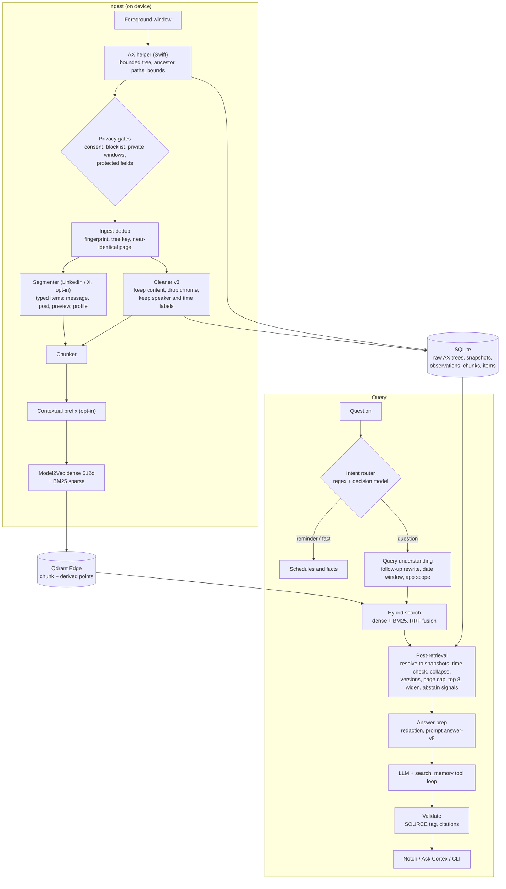
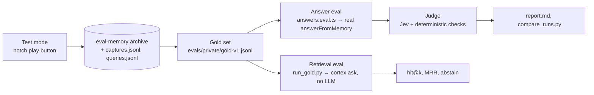

# Cortex

> **Renamed from Rewind.** Binaries, crates, env vars (`REWIND_*` → `CORTEX_*`) and the bundle id (`app.rewind.*` → `app.cortex.*`) now use the Cortex name. On first launch, an existing `~/Library/Application Support/Rewind` data directory is moved to `Cortex`. macOS treats the renamed app as new, so Accessibility and Screen Recording permissions must be granted again.

The macOS local-memory CLI has two commands: `cortex capture` and `cortex ask "question"`. It reads foreground Accessibility text, stores original snapshots in local SQLite, and searches a persistent local Qdrant Edge index. Cortex is the macOS UI for this same engine: the app bundles `cortex desktop`, shares the canonical `local-memory` archive and Qdrant index with the CLI, and uses the same capture cleaner, chunking, embeddings, hybrid retrieval, deduplication, and evidence preparation. See [implementation status](docs/implementation-status.md) for verification notes.

## How it works

Cortex is a local RAG system over your own screen. Everything up to the answer step runs on the Mac; only the final prompt (redacted) goes to a model, and only if one is configured.



The engine is one Rust crate, [`crates/cortex`](crates/cortex/src). The CLI (`cortex capture`, `cortex ask`) and the desktop app (which runs `cortex desktop` behind a private Unix socket) share the same archive, index and code path.

### 1. Capture

The Swift Accessibility helper reads the frontmost window on each poll, bounded to 5,000 nodes, 128 KiB of text and 750 ms. Each node keeps its role, value, a short ancestor path (for example "inside `Conversation`" versus "inside the sidebar") and its visible bounds. That structure is what lets the cleaner tell content from navigation later.

Before anything is stored:

* Capture only runs after an explicit opt-in and macOS permission.
* Protected fields are skipped before their values are read.
* Apps on the blocklist ([`blocklist.rs`](crates/cortex/src/blocklist.rs)), which covers terminals and code editors by default, are dropped in memory. Cortex is for questions about your life, not your shell history.
* The desktop app skips private and unknown browser contexts, credential apps and its own windows.

The raw tree is saved to SQLite so a better cleaner can re-process it later. Trees are deleted 7 days after a snapshot was last seen ([`rawtrees.rs`](crates/cortex/src/rawtrees.rs)), because they make up about 94% of the database.

### 2. Dedup at ingest

The same window is captured again and again, so [`dedup.rs`](crates/cortex/src/dedup.rs) checks the cheapest test first:

1. **Exact.** A SHA-256 of app, URL and cleaned body. A match adds an *observation* (a sighting with a timestamp) to the existing snapshot.
2. **Same tree.** A hash of the text-bearing parts of the AX tree. A match skips the cleaner entirely.
3. **Near-identical page.** At least 0.9 word overlap with a recent snapshot of the same page, *and* identical numbers, capitalised words and negations. A changed amount, name or "not" always counts as a new snapshot, because a revised quote is exactly what someone asks about.
4. **Shared chunk text.** Behind a flag, off by default.

A snapshot is a distinct state of a page. Observations record every time it was on screen. Date filters use observations, not the snapshot's creation time.

### 3. Cleaning

[`cleaner.rs`](crates/cortex/src/cleaner.rs) (version 3) is deterministic: no model is involved. It sorts nodes into regions (main content, navigation, toolbar, composer, unknown), then sorts each node into content, metadata, control or boilerplate. It keeps conversation and document text in reading order, joins adjacent fragments, collapses duplicate labels, and keeps speaker names and displayed message times next to their messages. It drops sidebars, tab strips, address bars, Copy, Rate and Dictate buttons, prompt placeholders and app boilerplate.

Every dropped node gets a recorded reason. Each snapshot gets a quality label (`main_content`, `uncertain`, `navigation_only`) and a coverage score. A navigation-only capture is kept as raw evidence but never indexed. When it can't find the content region with confidence, the cleaner keeps the text and marks the snapshot `uncertain` instead of throwing it away. `capture --clean-dry-run` and `--apply-cleaning` re-run a new cleaner over the saved trees.

### 4. Chunking

There are two chunkers. Which one runs depends on the page.

**Page chunker (default).** `cleaner::chunks` splits a cleaned body into chunks of about **1,600 characters**, with no overlap. It splits at message, paragraph and sentence boundaries, never inside a sentence. It treats the Devanagari danda and CJK full stops as sentence ends. It keeps a heading, a `label:` line, a `Q:` line or a speaker marker (`You said:`, `<name> sent the following message:`) in the same chunk as the text that follows it. This configuration (characters, label-aware boundaries, no overlap) won the chunking eval against the older byte-based chunker and against overlap variants. Each chunk stores its snapshot ID and byte span, so citations point back to exact text.

**Structure-aware items (LinkedIn and X, `CORTEX_SEGMENTS=1`).** Feeds and chats come out badly as one long page. [`segment.rs`](crates/cortex/src/segment.rs) runs *before* cleaning and splits the AX tree into typed items (`message`, `post`, `preview`, `profile`, `other`, and `noise`, which is dropped) using the page's own container labels. An item's identity is a hash of its site, kind, thread, author, displayed time and text, so scrolling a feed only adds the posts that are new, and an unchanged chat adds nothing. A post is one chunk. Messages are grouped per thread up to the size target, each keeping a `<sender> (<time>):` line. Every chunk gets a deterministic header built from page strings, for example `LinkedIn chat with Suchi · FRIDAY 10:08 PM`. The header is embedded with the text and shown to the answer model as a `Context:` line. Details: [structure-aware chunking](docs/structure-aware-chunking.md).

**Contextual prefix (opt-in, `CORTEX_CONTEXT_ENABLED=1`).** For pages that are not segmented, a model can read the whole capture and write a 1–3 sentence context for each chunk (who wrote it, where it appeared, when). The context is validated: it is rejected if it names a handle, email, URL or number that is not in the capture. Only the index sees `context + body`. Stored evidence and citations stay raw. Details: [contextual retrieval](docs/contextual-retrieval.md).

### 5. Indexing

Each chunk becomes one Qdrant Edge point with two vectors:

* **Dense.** Model2Vec `potion-base-32M` (512 dimensions), a pinned revision with a checked SHA-256, the same preprocessing for documents and queries.
* **Sparse.** Local BM25.

The payload holds app, domain, URL, capture time, last-seen time, source type, `point_type`, model version and, for item chunks, kind, author, displayed time and header. Hourly and daily extractive summaries, topic labels and entity mentions are indexed too, as separate `derived` points that link back to snapshot IDs. If the model, preprocessing or chunking format changes, `index_version` changes too, and the engine requires `--rebuild-index`, which rebuilds Qdrant from the SQLite chunks.

### 6. Retrieval

`retrieve` in [`main.rs`](crates/cortex/src/main.rs) runs one hybrid query:

1. **Query understanding.** In the app, a short follow-up or one that uses pronouns is first rewritten into a standalone query; self-contained questions skip this step. Then the question is turned into filters:
   * [`timewin.rs`](crates/cortex/src/timewin.rs) turns "yesterday", "last Tuesday", "this morning", "in October" and similar phrases into a local-time window. A phrase it doesn't understand gives no window rather than a wrong one.
   * [`appscope.rs`](crates/cortex/src/appscope.rs) adds an app filter only for phrases like "in Slack" or "my Notes app", not for "slack in the rope".
2. **Observation prefilter.** With a time window, only chunks of snapshots actually *seen* in that window can compete for a slot.
3. **Hybrid search.** Dense and BM25 each fetch 80 candidates, and Qdrant fuses them with **RRF** (k = 60, equal weights) into 40. Ties are broken by point ID, so results are reproducible. The eval tried dense-only, BM25-only, BM25 weighting, dense rerank and a keyword bonus. None beat plain hybrid on both corpora, so all of them are off.
4. **App fallback.** If an app-scoped search comes back empty, it runs again without the app filter.

### 7. Post-retrieval

The 40 fused points are turned into at most **8 sources** for the model:

* **Resolve.** A point is a chunk, a shared chunk or a derived summary. Each one is mapped back to the snapshot(s) it came from. An item chunk resolves to every snapshot that held all of its items. One of them represents the chunk; the rest are listed as "other captured versions".
* **Time check.** Each snapshot must have an observation inside the window. If not, it is dropped.
* **Collapse.** Hits with the same app, domain and cleaned body (the same page refreshed) are merged into one source. Their matched chunks are pooled, and the best score is kept.
* **Versions** ([`versions.rs`](crates/cortex/src/versions.rs)). Near-identical results are merged (Jaccard ≥ 0.9 with the same numbers, names and negations). The versions that remain of one page are ordered by what the question asks for: newest first by default, oldest first for "original", "before" or "first".
* **Page cap.** At most 2 results per page, so one long page can't fill every slot.
* **Chunk selection.** Each source carries up to 3 chunks: the best match plus the next-highest, shown in page order. In the app, the top 3 sources are widened with neighbouring chunks (up to 6 per source), because in a chat the matched chunk is often the repeated sidebar, and the actual message sits right after it. Each source's evidence is capped at 4,500 characters (7,500 when widened). When text has to be cut, the best chunk gets the space first.
* **Abstain signals** ([`abstain.rs`](crates/cortex/src/abstain.rs)). Cheap, deterministic scores:
  * the normalised fused score;
  * dense similarity between the question and the top results;
  * the share of the question's content words found in the evidence;
  * the share of question terms that appear nowhere in the index;
  * whether named identifiers (invoice numbers, booking codes) actually appear in the evidence.

  The thresholds are tuned on the dev split. Without an LLM, an abstain prints "no matching evidence". With an LLM, the model still sees the question plus the evidence, marked as weak, and makes the call itself.

### 8. Answer generation

[`answer_pipeline.rs`](crates/cortex/src/answer_pipeline.rs) builds one prompt (`PROMPT_VERSION` `answer-v8`) for both the CLI and the app. It contains:

* the question and the local date, time and timezone;
* the evidence, each source labelled with its snapshot ID;
* item `Context:` headers, and permanent facts when they exist.

Before anything leaves the Mac, [`cloud_redaction.rs`](crates/cortex/src/cloud_redaction.rs) masks credentials, card numbers, financial identifiers and amounts.

In the app the model can call `search_memory` (at most 3 rounds, 45 seconds) to run another targeted search, for example after resolving "yesterday" to a date. The reply must start with `SOURCE: memory | general | mixed | none`. `memory` and `mixed` answers must cite snapshot IDs that were actually shown. An invented ID fails validation under any label. Messages that look like reminders or facts are routed away from this path before retrieval (see [chat intent routing](docs/chat-intent-routing.md)).

## Local memory CLI (macOS only)

Requires macOS, Rust/Cargo, Swift compiler/Xcode Command Line Tools, and internet access once to download the pinned model. No browser extension or Qdrant server is needed.

```sh
cd /Users/abhinavvashisht/workspace/rewind
cargo build -p cortex
```

In Terminal 1, start capture. The command requests Accessibility permission for the stable helper at `~/Library/Application Support/Cortex/local-memory/cortex-ax-helper`. Enable that item in **System Settings → Privacy & Security → Accessibility**, then return to the screen you want to capture. The process checks permission again without a restart. Keep Terminal 1 running; stop it with Ctrl-C.

```sh
target/debug/cortex capture
# For the full text and metadata of each observation:
target/debug/cortex capture --print
```

In Terminal 2, ask a question while capture is running or after it stops:

```sh
target/debug/cortex ask "What did Lokesh say about openings?"
```

The two processes communicate through a private Unix socket while capture is running. If capture is stopped, `ask` opens the local index itself. `CORTEX_STATE_DIR` overrides the default data directory (`~/Library/Application Support/Cortex/local-memory`). In the first capture or ask, Model2Vec downloads `minishlab/potion-base-32M` at revision `1e5a03f8eeb2c98b928fbbd846f22f816360919f` into that directory. The model file is checked against SHA-256 `99f6c33204c9231a7391871b7a3c91409b532c8f587a9ea44fc282303d8dec28`. Embeddings are 512 dimensions, generated by `model2vec-rs` 0.3.0 with its default preprocessing for both ingestion and queries. If the pinned model or preprocessing is changed in code, run `target/debug/cortex capture --rebuild-index`; this rebuilds Qdrant from the SQLite cleaned chunks.

Each poll records an observation. Identical cleaned content at the same app and URL reuses one snapshot ID while updating `last_seen_ms`, sighting count, and elapsed first-to-last span. The helper records bounded AX ancestor paths and visible bounds; SQLite retains the original ordered AX nodes and distinct raw variants alongside cleaned `body`, cleaner version, quality, coverage, and per-node removal reasons. The cleaner selects conversation/document text, removes known navigation and action controls, joins adjacent fragments, and preserves exposed speaker and message-time labels. A navigation-only capture is retained as raw AX evidence but excluded from search. Long clean bodies are split at message, paragraph, or sentence boundaries into chunks of about 1,600 bytes, each pointing to its snapshot and byte span. Qdrant stores a dense Model2Vec and local BM25 sparse vector per chunk, with app, domain, URL, capture and last-seen times, source type, and model version as payload. `ask` uses Qdrant's hybrid Query API with RRF fusion and loads the original SQLite snapshots. It filters for recognized apps, domains, and dates mentioned in a question, and collapses repeated cleaned evidence across page refreshes. The observation time shown in results is distinct from any message time displayed in the captured text.

To review and migrate captures stored by an older CLI version, stop `capture` and run:

```sh
target/debug/cortex capture --clean-dry-run
target/debug/cortex capture --apply-cleaning
```

The dry run shows selected before/after text and removal reasons. Applying creates a `memory.pre-clean-vN.sqlite3` backup, rewrites searchable bodies from saved AX nodes, merges duplicate snapshots while preserving their observations, regenerates derived entries, and rebuilds Qdrant. Older rows without saved AX nodes remain in SQLite and are marked `content_unavailable` rather than indexed with uncleaned text.

Hourly and daily UTC summaries, topic labels, and entity mentions are generated on a background thread after each new snapshot. They are extractive and link to exact snapshot IDs in SQLite. They get separate Qdrant points for discovery; answers still present original sources. This summarizer is `extractive-v1` (no LLM). Entity labels are heuristic mentions, not identity claims.

Without an LLM, `ask` prints ranked evidence and snippets. An OpenAI-compatible chat-completions endpoint is optional:

```sh
export CORTEX_LLM_URL='https://your-provider.example/v1/chat/completions'
export CORTEX_LLM_MODEL='your-model'
export CORTEX_LLM_API_KEY='your-key'
target/debug/cortex ask "What did I ask Saurav?"
```

No capture is sent to a cloud service during ingestion. Before an optional LLM request, the query and retrieved context pass through pattern-based redaction for common credentials, payment cards, financial identifiers, and monetary amounts. Names, places, email addresses, phone numbers, dates, and ordinary URLs may be sent to the configured provider. Credentials are read from environment variables and never hardcoded. Pattern redaction can miss uncommon PII or secrets; leave the LLM variables unset if the source is too sensitive to send. Original local SQLite text is unredacted.

Capture includes normal and private browser windows when Accessibility exposes them, plus native apps, chats, editors, and terminals. It does not require a browser extension. A `browser_private` source type is inferred only when the window title says Incognito or Private Browsing; that label is heuristic. Protected controls are omitted before their values are queried. Canvas-rendered text, virtualized or hidden chat messages, apps that expose no text, missing window geometry, and unavailable browser URLs can leave gaps. Traversal is bounded to 5,000 nodes, 128 KiB of text, and 750 ms per observation; `--print` displays reported limitations. The CLI prints skip reasons such as `accessibility_not_granted`, `session_inactive`, `no_focused_window`, and `no_visible_text`.

### Manual macOS check (16 October 2026)

With Accessibility granted, Terminal 1 ran `target/debug/cortex capture --print` while a Safari page containing an invented chat was foreground. It reported `new #2`, the full `file:///private/tmp/cortex-browser-check.html` URL, sender and displayed time lines, then `seen #2` on later polls. SQLite contained one snapshot with rising `sightings` and observations, and its `embedding_model`/`indexed` fields confirmed Model2Vec indexing. Terminal 2 ran `target/debug/cortex ask "What did Lokesh say about openings?"`; Qdrant hybrid retrieval returned the Safari snapshot and original source URL. A separate Chrome Incognito window on the same local page was captured with its full file URL and `some_element_bounds_unavailable:2`; snapshot #9 was marked `browser_private`. A private window was therefore read on this Mac; coverage of other browsers and protected or canvas content remains app dependent.

## Workspace

Scheduled tasks / Reminders → Ask Cortex → Memories (Permanent memory / Recent activity memory) → Agent Space. Home, Timeline, capture/privacy settings and MCP setup remain available. See [workspace behavior, migration and dependencies](docs/workspace.md).

## Run on macOS

Requirements: Rust/Cargo, Swift compiler/Xcode command-line tools, Node.js 20+, and npm. The Tauri build embeds the local daemon and its macOS Accessibility helper; opening the app starts the daemon automatically. Capture stays off until you enable it.

```sh
cd apps/desktop
npm ci
npm run tauri dev
```

In **Settings → Capture & privacy**, record your capture choice, enter any excluded app bundle IDs, and press **Start capture**. The app requests macOS Accessibility access only after that action. Grant access to the Cortex capture helper in System Settings, return to the app, and press Start capture again. Pause and Stop are in the same screen. Normal browser windows can be read; private/incognito and unknown browser contexts, credential apps, and protected fields are skipped. Cortex's own windows are excluded from capture.

The desktop shell is notch-first: a Cortex logo sits at the top center of every connected display, including full-screen Spaces and Stage Manager with settings and chat controls. Click a display’s logo (or double-tap the configured key to use the display under the pointer) for a single-entry cortex. The input collapses into the cortex animation and returns an answer with local sources plus an empty field for follow-ups. The chat control opens session history with a scrolling session list, per-session threads, and an undock button. Configure the trigger in **Settings → Cortex & notch**; macOS may ask for Input Monitoring or Accessibility permission for the global double-tap. In the browser preview, `/index.html?window=notch&preview=1&mode=compose` shows the same drop without the native shell.

To build the development macOS app bundle:

```sh
npm run tauri build -- --bundles app
```

The browser-only preview is `npm run dev` from `apps/desktop`; choose **Not now** during onboarding. The browser preview cannot call the authenticated daemon. For an isolated invented source, run `cargo build -p cortex-daemon` and `CORTEX_STATE_DIR="$(mktemp -d)" target/debug/cortex-daemon --seed-synthetic` from the repository root. Do not use your normal state directory for fixtures.

## Evals

Evals measure two separate things: did retrieval find the right page, and was the final answer right. Both run on a hand-built **eval archive**, never on your real memory, and every run works on a throwaway copy of it.



### The eval archive and the gold set

Turn on **Test mode** in Settings, then use the notch play button to record pages on purpose. They go to `~/Library/Application Support/Cortex/eval-memory/`, kept apart from `local-memory/`. While test mode is on, every question is answered from that archive. `captures.jsonl` logs the cleaned body and the exact chunks of each new page, and `queries.jsonl` logs what retrieval returned. See [evals/TEST_MODE.md](evals/TEST_MODE.md).

The gold set (`evals/private/gold-v1.jsonl`, git-ignored because it holds real page text) is written from those logs. Each question has:

| field | purpose |
|---|---|
| `expected_behavior` | `memory`, `mixed`, `general`, `clarify` or `abstain`: what a good reply does |
| `reference_answer`, `answer_facts` | the answer, and the facts a correct reply must state |
| `support` | snapshot ID, chunk and text that hold the answer |
| `wrong_answers` | plausible wrong answers, used to catch hallucination |
| `family`, `split`, `variant_of` | question type (attribution, chat lookup, scheduling…), `dev`/`test` split, and noisy rewordings of a clean question |

Tune on `dev`. Report `test` once.

### Retrieval eval (no LLM)

`python3 evals/tools/run_gold.py` runs every question through `cortex ask` with no model configured and records the rank at which a supporting snapshot appears. A page listed under "other captured versions" counts as a hit. For `abstain` and `general` questions it checks whether retrieval abstained. Metrics are hit@1, hit@3, hit@8 and MRR. Use this for anything on the ingest or retrieval side (cleaner, chunking, fusion, filters): it's fast, free and deterministic. `compare_retrieval.py` diffs two runs. `cortex eval` is the older equivalent over invented fixtures.

### Answer eval

The answer eval runs the app's real answer flow headless, so it measures the same thing a user sees ([apps/desktop/evals](apps/desktop/evals/README.md)):

1. [`harness.ts`](apps/desktop/evals/harness.ts) starts a throwaway `cortex desktop` in test mode on a copy of the archive, plus [`eval_bridge`](apps/desktop/src-tauri/examples/eval_bridge.rs), a headless build of the Tauri commands the UI calls (`openrouter_chat` with the tool loop, the follow-up rewriter, `daemon_request`).
2. [`answers.eval.ts`](apps/desktop/evals/answers.eval.ts) calls the page's own `answerFromMemory` for each question. A small shim routes its `invoke` calls to the bridge. Answers, source tags and hit IDs go to `evals/private/answers/<run>.jsonl`. The run is resumable.
3. [`judge.eval.ts`](apps/desktop/evals/judge.eval.ts) grades the answers file.

`evals/run.sh` does all three in one command (local MLX model by default, or `EVAL_CLOUD_MODEL=<openrouter model>`). `evals/run-models.sh` runs the same gold set across a list of models. `evals/run-context.sh` keeps the answering model and judge fixed and changes only the retrieval input (the contextual archive), so any difference comes from retrieval.

### LLM-as-a-judge: Jev

The default judge is **Jev** (`~typesafe/jev-latest` on OpenRouter), a classifier rather than a chat model. Instead of asking a model to write a grade, the bridge sends `POST /api/alpha/decisions` with the reply as `state` and a set of typed questions ([`judge-lib.ts`](apps/desktop/evals/judge-lib.ts)):

| question | type | asks |
|---|---|---|
| `verdict` | choice: correct / partial / incorrect | graded against the reference and required facts, with a rubric per `expected_behavior` (for example, `abstain` is correct only if the reply declines without guessing) |
| `behavior_ok` | yes/no | did the reply do the right *kind* of thing (answer from memory, from knowledge, cover both readings, or decline) |
| `states_wrong_answer` | yes/no | does it present a known wrong answer or an invented fact |
| `facts_covered` | yes/no | does it state every required fact |

Jev returns probabilities, not prose. Verdicts are therefore consistent between runs and come with a confidence score. No JSON parsing or retry loop is needed.

The judge always runs next to **deterministic string checks**: required facts found in the text, known wrong answer mentioned, `SOURCE` tag allowed for the expected behavior, and a supporting snapshot cited or retrieved. The report breaks results down by behavior, family, split, and clean versus noisy questions. It lists every question where the string check and Jev disagree, and every verdict with confidence under 0.7. Those are the ones to read by hand. `compare_runs.py` diffs two judged runs per family and lists the questions that flipped. On groups of fewer than 30 questions, Jev has about 5 points of noise.

`EVAL_JUDGE_KIND=chat EVAL_JUDGE_MODEL=<model>` switches to a prompted chat-model judge with the same rubric and JSON output. Add `EVAL_JUDGE_PROVIDER=local` to keep it on the Mac. With Jev or any OpenRouter judge, the question, reference facts and reply leave the machine.

### Decision-model eval

`npm run eval:decision` (opt-in, never in CI) runs the reminders and memories decision model over about 45 labelled phrasings with a fixed clock and synthetic data. It reports accuracy per action and timing correctness, and the run fails on any **false write**. The grading logic is unit tested without a model.

## Assistant answers (memory, general knowledge, date)

Cortex answers from your captured activity when a question is about your own life, and from the model's general knowledge when it is not. Every question goes to the model with the current local date, weekday, time and timezone, plus whatever evidence retrieval found. Weak or empty retrieval is flagged to the model, which decides; there is no canned "no match" reply.

- One prompt (`answer_pipeline.rs`, `PROMPT_VERSION` `answer-v8`) serves the desktop app (through the local `POST /v1/assistant/prepare` route, which returns the finished messages) and the CLI `ask`. Evidence stays redacted exactly as before; the app only forwards the messages to OpenRouter (`openrouter_chat`).
- **Source label.** The model's first line is `SOURCE: memory | general | mixed | none`. The app strips it and shows a small label for `general` ("General knowledge") and `mixed`, and keeps evidence only for `memory` and `mixed`. `none` means a personal question nothing answered. If the tag is missing it is inferred: cited snapshot IDs mean `memory`, and no evidence shown means `general`.
- **Checks.** `memory` and `mixed` answers must cite snapshot IDs that were shown; `general` and `none` answers need no citation. Invented IDs fail under any label.
- Follow-up questions are rewritten into a standalone search query (a second cloud call) only when the question is short or uses pronouns; self-contained questions skip it.
- The CLI uses the model whenever `CORTEX_LLM_URL` is set; without one it still prints ranked evidence.

### Read-only tools

The model may call tools before answering (OpenAI-style `tools` / `tool_calls`, which OpenRouter passes through). The loop lives in the desktop shell (`apps/desktop/src-tauri/src/tools.rs`): at most 3 tool rounds and 45 seconds overall, then the model must answer without tools. Tools:

- `search_memory(query, from?, to?, app?)`: another targeted search of the captured evidence, for example after resolving "yesterday" to a date or when the first evidence misses a person. `from`/`to` are `YYYY-MM-DD` or `YYYY-MM-DDTHH:MM` in local time (a bare `to` date includes that day). The engine runs it (`POST /v1/assistant/search`) with the same retrieval, evidence preparation and redaction as the first search. Hits it finds are added to the answer's evidence when the answer cites memory.
- `list_calendar_events(from, to)`: defined behind a `Calendar` interface and offered only when a calendar is connected. None is connected yet (real access is Phase 3); tests use a fake.

Tool results are untrusted data like evidence: capped at 12,000 characters, and anything not already redacted by the engine goes through the engine's cloud redaction (`POST /v1/assistant/redact`) before it reaches the provider; if redaction fails, nothing is sent. The model tool loop has no write tools. The chat intent router separately handles explicit fact and schedule commands before invoking this answer loop.

**Models.** Tool calling needs a model that supports it; on OpenRouter, filter the model list by the `tools` supported parameter. If the provider rejects the request with tools (HTTP 400, 404 or 422), Cortex retries once without tools and answers from the evidence it already has, so an unsupported model still works. No model has been tested live yet; do not read this section as a recommendation of one.

## Components

| Path | Current purpose |
|---|---|
| `crates/capture`, `crates/memory`, `crates/daemon` | Consent-gated sanitization, SQLite/FTS, macOS capture worker, authenticated local API, settings, and deletion |
| `crates/platform-mac` | Bounded read-only foreground Accessibility helper; the desktop daemon reads normal browser windows and skips private/unknown browser contexts; protected controls are omitted |
| `crates/platform-win` | Earlier feasibility probe only; Windows implementation is out of scope |
| `apps/desktop` | Tauri/React onboarding, privacy controls, Scheduled tasks / Reminders, Ask Cortex, Memories, and Agent Space |
| `crates/mcp` | Shared task/memory MCP bridge and explicit client-config helper; [workflow and setup](docs/shared-workspace.md) |
| `services/control`, `services/gateway`, `packages/prompts` | Account metadata/quota, authenticated inference gateway, prompt contracts, and a deterministic development provider |
| `apps/website` | Responsive public preview with disabled downloads until artifacts are configured |
| `infra` | Signed release metadata and verification tooling; requires real signed installers and keys |

Each component has local setup notes. The website and services run independently; the desktop shell does not yet implement production OIDC sign-in or live cloud inference. The specification is the design baseline, not a claim that every feature has shipped.

## Verify

```sh
cargo test --workspace
npm --prefix apps/desktop ci
npm --prefix apps/desktop run build
npm --prefix apps/desktop test
cargo test --manifest-path apps/desktop/src-tauri/Cargo.toml
npm --prefix crates/mcp ci
CORTEX_DAEMON_BIN="$PWD/target/debug/cortex-daemon" npm --prefix crates/mcp test
npm --prefix services/control test
npm --prefix services/gateway test
npm --prefix packages/prompts test
npm --prefix apps/website test
node --test infra/test/release.test.mjs
```

The MCP integration test uses a temporary archive with invented data. No verification command requests macOS Accessibility permission or enables live capture.
