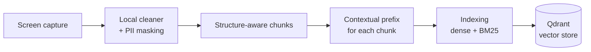
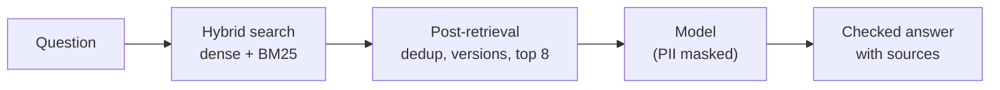
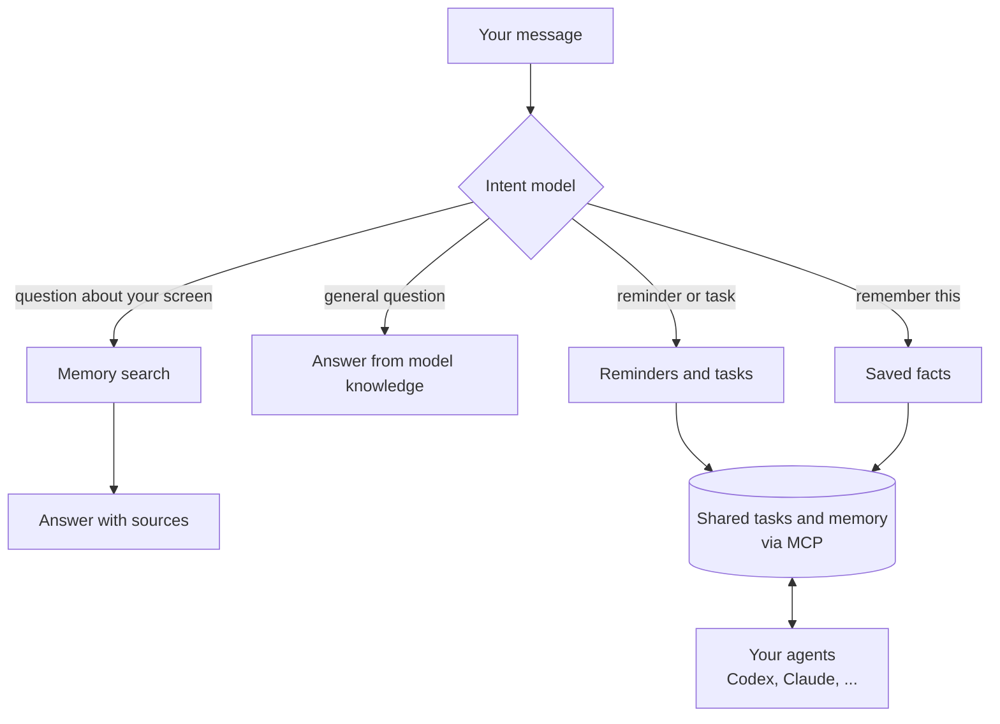

# Cortex

Cortex is a local-first brain for you and your agents. It remembers everything that happens on your screen and lets you ask about it later. It spots reminders and tasks in your conversations and suggests them.

It is also a shared task and memory space for your agents. Start a task in Codex, hand it to Claude, and the context goes with it, with no copying and pasting. Memory tools like mem0 store facts, but they don't help agents split up and pass work between each other. Cortex does.

<p align="center"></p>


## How it works

Cortex reads what is on your screen and keeps it in a local RAG on your Mac. Then you can:

* **Ask** questions about anything you saw, read or wrote.
* **Remember** things like emails and phone numbers.
* **Create reminders and tasks** from your conversations, and share them with your agents.
* **Get nudged** about things you might have missed, like a meeting or a task someone asked you about. This is planned and not active in this build.



* **Screen capture:** reads the text of the window you are in, only after you opt in. Terminals, password managers and private windows are skipped.
* **Local cleaner:** strips menus, buttons and sidebars, and keeps who said what and when.
* **PII masking:** card numbers, credentials and amounts are masked before anything is sent to a model.
* **Structure-aware chunks:** posts, messages and paragraphs stay whole instead of being cut at a fixed size. LinkedIn and X get the full treatment (opt-in); other pages are split at paragraph and sentence boundaries.
* **Contextual prefix:** each chunk gets a short note on where it came from and who wrote it, so it can be found later. Optional, off by default.
* **Indexing:** every chunk gets a dense (meaning) vector and a keyword (BM25) vector.
* **Qdrant:** the on-device vector store. The original text stays in local SQLite.

When you ask a question, Cortex finds the best chunks, cleans up the results, and sends them to a model that answers with sources.



The sections below go deeper on each step.

### Chunking

Search works on small pieces of text, not whole pages, so every capture is split into chunks first. How it is split matters: a chunk that cuts a thought in half is hard to find and hard to answer from.

**Normal pages.** Pages are split into chunks of roughly 1,600 characters, at paragraph and sentence boundaries. A heading stays with the text under it, and a speaker's name stays with what they said.

**Feeds and chats (LinkedIn, X).** Splitting a feed by size mixes unrelated posts together. Here the page is split by its real structure instead: one post is one chunk, and a chat is grouped by conversation. Each chunk knows its author and time, so "what did Suchi say on Friday" works. Scrolling a feed only adds the posts that are new. Details: [structure-aware chunking](docs/structure-aware-chunking.md).

### Contextual prefix

A chunk on its own often means nothing. "Sounds good, let's do Thursday" doesn't say who said it, where, or about what.

A model reads the whole page and writes one or two sentences of context for each chunk, for example "A LinkedIn message from Suchi about moving the design review." That context is stored with the chunk for search, so questions about who said something, or where it appeared, can find it. The original text and the sources shown to you are never changed. It is optional and off by default. Details: [contextual retrieval](docs/contextual-retrieval.md).

### Indexing

Each chunk is stored in Qdrant, on your Mac, in two ways. Both are needed because they fail in opposite ways.

* **Dense (meaning).** Finds text that says the same thing in different words. "Flight confirmation" finds "your booking is confirmed". It is weak on exact names, numbers and codes.
* **Sparse (BM25, keywords).** Finds the exact words. It catches a name, an invoice number or a booking code that a meaning search blurs. It misses paraphrases.

Cortex searches both and merges the results.

### Intent routing

Not every message is a question. Before searching anything, a model reads the message and decides what you want, then sends it to the right place.



* "What did Maya say about the review?" goes to memory search.
* "Remind me to call mom every Sunday at 10" creates a reminder.
* "Remember Rajesh's phone number is 213132" saves a fact.
* "Cancel that reminder" or "move it to Thursday" updates an existing one.

If the request is unclear, for example "at 5" without am or pm, it asks you instead of guessing. Creating a reminder shows an Undo button, and cancelling or changing a saved item asks you to confirm first.

Reminders, tasks and facts live in one shared space, and your agents read and write it through MCP. A task started in one agent can be picked up by another, with its context attached. Setup: [shared workspace](docs/shared-workspace.md). Routing details: [chat intent routing](docs/chat-intent-routing.md).

### Retrieval

When the message is a question, Cortex finds the best chunks.

1. **Understand the question.** A follow-up like "what about him?" is rewritten into a full question. Phrases like "yesterday" or "last Tuesday" become a date range, and "in Slack" limits the search to that app.
2. **Search both ways.** Meaning search and keyword search each return their best matches.
3. **Merge.** The two lists are combined into one ranking (Reciprocal Rank Fusion), so a chunk that ranks well in both rises to the top.

### Post-retrieval

The raw matches are not good enough to hand to a model. A page that was on screen all afternoon shows up dozens of times, and one long page can crowd out everything else. Cortex cleans the list first:

* **Merge repeats.** The same page captured many times counts once.
* **Keep real changes.** If a number, name or "not" changed between two versions of a page, both are kept, because a revised price or a reversed decision is what people ask about. The newest comes first unless you ask for the original.
* **Limit per page.** At most two results from one page, so one long page can't fill the list.
* **Top 8.** Only the eight best sources go to the model. For the best few, nearby text is added, so a chat match comes with the message around it.
* **Weak match check.** If nothing really matches the question, the model is told the evidence is weak. It can say it doesn't know instead of guessing.

### Answers

The model gets your question, today's date, and the evidence, with credentials, card numbers and amounts masked first. If the evidence misses a person or a day, it can run another search before answering.

Every answer says where it came from: your memory, general knowledge, or both. Answers from memory must cite the sources they used, and an answer that cites a source it was never shown is rejected.

## Build and run locally

You need macOS, Rust, the Xcode command-line tools (for Swift), and Node.js 20+.

```sh
git clone <this repo> && cd cortex
cargo build -p cortex
```

Run the engine from the terminal. The first run downloads the embedding model (once) and asks for Accessibility permission.

```sh
target/debug/cortex capture
target/debug/cortex ask "what did Lokesh say about openings?"
```

Run the desktop app:

```sh
cd apps/desktop
npm ci
npm run tauri dev
```

Then open **Settings → Capture & privacy** and press **Start capture**. Capture is off until you do. To build the app bundle, run `npm run tauri build -- --bundles app`.

To get written answers instead of ranked sources, point Cortex at any OpenAI-compatible model:

```sh
export CORTEX_LLM_URL='https://openrouter.ai/api/v1/chat/completions'
export CORTEX_LLM_MODEL='anthropic/claude-haiku-5.5'
export CORTEX_LLM_API_KEY='your-key'
```

## Workspace

Scheduled tasks / Reminders → Ask Cortex → Memories (Permanent memory / Recent activity memory) → Agent Space. Home, Timeline, capture/privacy settings and MCP setup remain available. See [workspace behavior, migration and dependencies](docs/workspace.md).

## Evals

Two things are measured: did retrieval bring back the right page, and was the final answer right. Both run on a separate eval archive, never on your real memory.

### How the eval set was made

1. Turn on **Test mode** in Settings and record real pages with the notch play button. They go into their own eval archive ([how test mode works](evals/TEST_MODE.md)).
2. A coding agent read the recorded text and wrote about 300 questions in the way people actually type them: short, lowercase, half-remembered. See [the prompt](docs/cortex-eval-writer-agent-prompt.md).
3. The questions cover 14 kinds of lookup: who wrote a post, what someone said in a chat, scheduling, answers spread across several chunks, exact numbers and links, contact details, follow-ups, and questions that should be answered from general knowledge or not at all. A quarter of them also have a messy twin with typos and Hinglish.
4. Every question stores the expected behavior, the reference answer, the facts a correct reply must contain, the page that holds the answer, and wrong answers to watch for. Questions are split into dev (for tuning) and test.

The set contains real messages, so it stays on your machine and is git-ignored.

### Measure retrieval

No model and no cost. Each question goes through search, and the script checks where the right page ranks.

```sh
cargo build --release -p cortex
python3 evals/tools/run_gold.py --split dev --out evals/private/retrieval_run.json
```

`hit@k` is how often the right page is in the top k results.

| | hit@1 | hit@3 | hit@8 |
|---|---|---|---|
| Today (default) | 0.81 | 0.91 | 0.95 |
| With contextual prefix | 0.84 | 0.91 | 0.95 |
| With structure-aware chunks (LinkedIn, X) | 0.77 | 0.91 | 0.96 |

266 questions whose answer is in memory. Structure-aware chunks lose a little at rank 1 but find more answers overall, and keeping promoted posts raises hit@8 to 0.98. The weakest areas today are scheduling (hit@1 0.44) and chat lookup (0.65).

### Measure answers, with an LLM as judge

This runs the real app flow for every question, then grades the reply. It calls a cloud model, so it costs money.

```sh
EVAL_CLOUD_MODEL=anthropic/claude-haiku-5.5 evals/run.sh
python3 evals/tools/compare_runs.py old.judged.jsonl new.judged.jsonl
```

The judge is **Jev**, a classifier from TypeSafe. It isn't a chat model. For each answer it gets the question, the reference answer and the required facts, and it returns:

* a verdict: correct, partial or incorrect;
* yes/no checks: right kind of reply, states a known wrong answer, covers every required fact;
* a confidence score for each, instead of an explanation.

Because it returns probabilities, the same answer gets the same grade every time. Simple string checks run next to it (are the required facts in the text, was a real source cited). The report lists every case where the two disagree, and every verdict under 0.7 confidence, to be read by hand.

Latest run (21 Oct 2026): Claude Haiku 5.5 answering, 300 questions judged.

| | correct | partial | incorrect |
|---|---|---|---|
| All questions | 73% | 8% | 19% |
| With structure-aware chunks | 80% | 6% | 14% |

By kind of question (default setup):

| | correct |
|---|---|
| Contact details | 94% |
| Exact details | 85% |
| Questions answered from memory | 77% |
| Should say "I don't know" | 78% |
| Memory vs general knowledge | 48% |
| Aggregation ("who asked about co-founding") | 20% |
| Ambiguous questions | 14% |

Treat small differences with care. Jev moves about 5 points on groups under 30 questions, and 51 of the 300 verdicts had confidence under 0.7. The structure-aware run judged 284 answers, not 300.

## Assistant answers (memory, general knowledge, date)

Cortex answers from your captured activity when a question is about your own life, and from the model's general knowledge when it is not. Every question goes to the model with the current local date, weekday, time and timezone, plus whatever evidence retrieval found. Weak or empty retrieval is flagged to the model, which decides; there is no canned "no match" reply.

- One prompt (`answer_pipeline.rs`, `PROMPT_VERSION` `answer-v8`) serves the desktop app (through the local `POST /v1/assistant/prepare` route, which returns the finished messages) and the CLI `ask`. Evidence stays redacted exactly as before; the app only forwards the messages to OpenRouter (`openrouter_chat`).
- **Source label.** The model's first line is `SOURCE: memory | general | mixed | none`. The app strips it and shows a small label for `general` ("General knowledge") and `mixed`, and keeps evidence only for `memory` and `mixed`. `none` means a personal question nothing answered. If the tag is missing it is inferred: cited snapshot IDs mean `memory`, and no evidence shown means `general`.
- **Checks.** `memory` and `mixed` answers must cite snapshot IDs that were shown; `general` and `none` answers need no citation. Invented IDs fail under any label.
- Follow-up questions are rewritten into a standalone search query (a second cloud call) only when the question is short or uses pronouns; self-contained questions skip it.
- The CLI uses the model whenever `CORTEX_LLM_URL` is set; without one it still prints ranked evidence.

### Read-only tools

The model may call tools before answering (OpenAI-style `tools` / `tool_calls`, which OpenRouter passes through). The loop lives in the desktop shell (`apps/desktop/src-tauri/src/tools.rs`): at most 3 tool rounds and 45 seconds overall, then the model must answer without tools. Tools:

- `search_memory(query, from?, to?, app?)`: another targeted search of the captured evidence, for example after resolving "yesterday" to a date or when the first evidence misses a person. `from`/`to` are `YYYY-MM-DD` or `YYYY-MM-DDTHH:MM` in local time (a bare `to` date includes that day). The engine runs it (`POST /v1/assistant/search`) with the same retrieval, evidence preparation and redaction as the first search. Hits it finds are added to the answer's evidence when the answer cites memory.
- `list_calendar_events(from, to)`: defined behind a `Calendar` interface and offered only when a calendar is connected. None is connected yet (real access is Phase 3); tests use a fake.

Tool results are untrusted data like evidence: capped at 12,000 characters, and anything not already redacted by the engine goes through the engine's cloud redaction (`POST /v1/assistant/redact`) before it reaches the provider; if redaction fails, nothing is sent. The model tool loop has no write tools. The chat intent router separately handles explicit fact and schedule commands before invoking this answer loop.

**Models.** Tool calling needs a model that supports it; on OpenRouter, filter the model list by the `tools` supported parameter. If the provider rejects the request with tools (HTTP 400, 404 or 422), Cortex retries once without tools and answers from the evidence it already has, so an unsupported model still works. No model has been tested live yet; do not read this section as a recommendation of one.

## Components

| Path | Current purpose |
|---|---|
| `crates/capture`, `crates/memory`, `crates/daemon` | Consent-gated sanitization, SQLite/FTS, macOS capture worker, authenticated local API, settings, and deletion |
| `crates/platform-mac` | Bounded read-only foreground Accessibility helper; the desktop daemon reads normal browser windows and skips private/unknown browser contexts; protected controls are omitted |
| `crates/platform-win` | Earlier feasibility probe only; Windows implementation is out of scope |
| `apps/desktop` | Tauri/React onboarding, privacy controls, Scheduled tasks / Reminders, Ask Cortex, Memories, and Agent Space |
| `crates/mcp` | Shared task/memory MCP bridge and explicit client-config helper; [workflow and setup](docs/shared-workspace.md) |
| `services/control`, `services/gateway`, `packages/prompts` | Account metadata/quota, authenticated inference gateway, prompt contracts, and a deterministic development provider |
| `apps/website` | Vite one-page public site with an illustrative demo; deploys independently to Vercel |
| `infra` | Signed release metadata and verification tooling; requires real signed installers and keys |

Each component has local setup notes. The website and services run independently; the desktop shell does not yet implement production OIDC sign-in or live cloud inference. The specification is the design baseline, not a claim that every feature has shipped.

## Verify

```sh
cargo test --workspace
npm --prefix apps/desktop ci
npm --prefix apps/desktop run build
npm --prefix apps/desktop test
cargo test --manifest-path apps/desktop/src-tauri/Cargo.toml
npm --prefix crates/mcp ci
CORTEX_DAEMON_BIN="$PWD/target/debug/cortex-daemon" npm --prefix crates/mcp test
npm --prefix services/control test
npm --prefix services/gateway test
npm --prefix packages/prompts test
npm --prefix apps/website test
node --test infra/test/release.test.mjs
```

The MCP integration test uses a temporary archive with invented data. No verification command requests macOS Accessibility permission or enables live capture.
